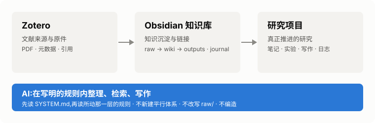

# Research workbench template: Zotero + Obsidian + AI

中文: [README.md](README.md) | English

> A folder layout and a set of written rules that tie together **literature (Zotero), distilled knowledge (Obsidian) and your active research project**, so an AI assistant can organize, search and draft inside rules you control. **This repo contains only the template: no real research content.**

## Fastest way: let the AI do it

Open Claude Code (or any agent that can read and write files) and send:

> I want to set up a personal research workbench. Read `AGENTS.md` and `TUTORIAL.md` in https://github.com/z-zhixiang/research-workbench-template and walk me through it. Tell me clearly which steps I must do myself (installing apps, opening a folder in an app, signing in) and do the rest. Do not invent facts about me; ask when you don't know.

`AGENTS.md` is in English and tells the AI to reply in your language. `TUTORIAL.md` is currently Chinese only.

## The idea

- **Zotero** keeps the papers and metadata. **Obsidian** keeps what you learned. The **research project** holds notes, experiments, writing and a log.
- One master file (`SYSTEM.md`) plus one rule file per layer. The AI reads them first, so it does not scatter files, start a parallel note system, or touch your raw material.
- `raw/` is read-only for the AI. Anything unknown is marked `待确认` (to be confirmed), never guessed.
- Tidying and maintenance run **only when you ask**; nothing happens in the background.
- Optional: `template/tools/fetch_xhs.py` archives a Xiaohongshu (RedNote) note (text, tags, images, top comments) into `knowledge-base/raw/web/`, add-only. It depends on the site's page layout and may stop working; it stops at a captcha and never bypasses it. Personal archiving only. The author has tried it on a single link.

## Keep your own data private

This repo is the template only. What you put into your own workbench (topic, advisor, notes, PDFs, Zotero data) is yours: **do not commit it to a public repo**. See `template/.gitignore.example`. Whatever the AI reads is sent to the model API.

## Status

Based on the author's own use, but **not yet walked through end to end by anyone else**; feedback welcome. How Zotero and Obsidian should be linked is deliberately **not** fixed as a rule yet: see the [roadmap](docs/design-notes.md#路线图).
