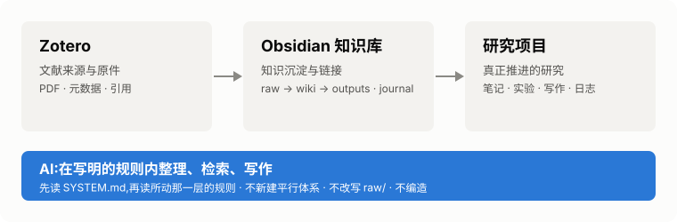

# 研究工作台模板:Zotero + Obsidian + AI

> 一套把「文献来源、知识沉淀、研究项目」串起来,并让 AI 在**明确规则**内帮你整理、检索、写作的目录与规则模板。**仓库里只有模板,没有任何人的真实研究内容。**



## 最快的用法:交给 AI

打开 Claude Code(或任何能读写文件的 AI),把下面这段话发给它:

> 我想建一套自己的研究工作台。请阅读 https://github.com/<你的用户名>/research-workbench-template 里的 `AGENTS.md` 和 `TUTORIAL.md`,按里面的步骤带我搭好。
> 需要我手动做的地方(安装软件、在软件里打开文件夹、授权登录)请明确告诉我,其余的你自己来。不要编造我没告诉你的信息,不知道的就问我。

## 它解决什么问题

- 文献散在各处,读过的内容没有沉淀,过一阵就忘了。
- AI 每开一个新对话都不知道你的规矩:文件乱放、另起一套平行目录、随手改你不想动的原始材料。

这套模板给出:**一份总纲 + 分层规则文件 + 固定路由表 + 跨会话恢复入口**。AI 每次先读总纲,再读要动的那一层的规则,就能在你定好的框架里干活。

## 结构

```
template/                      ← 复制这个文件夹到你自己的位置使用
  SYSTEM.md                    总纲:位置、各层关系、「在框架内改」原则
  knowledge-base/              Obsidian 知识库(把这个文件夹当作一个 vault 打开)
    CLAUDE.md                  这一层的规则
    raw/ wiki/ outputs/ journal/
  research-project/            一个研究项目(可以是一个 git 仓库)
    PROJECT.md  CONTEXT.md  research-log.md
    docs/agents/               路由与管理规则
    papers/ research-notes/ experiments/ writing/ references/ scripts/
```

Zotero 管文献原件(PDF 和元数据),Obsidian 管知识沉淀,AI 在规则内整理。

## 用归用,不外泄

- 这个仓库只放**模板**。你往里填的内容(研究方向、导师、笔记、PDF、Zotero 数据)属于你自己,**不要提交到公开仓库**。
- 建议把 `template/` 复制到你自己的位置使用;要用 git 管理的话,用**私有**仓库。`template/.gitignore.example` 给了一份参考。
- AI 读到的内容会发送到模型服务。含隐私的材料,先想好哪些允许它读。

## 现状(请如实看待)

- 这套结构来自作者的实际使用,但**作为模板,它还没有被其他人完整走通过**,欢迎反馈。
- **Zotero 与 Obsidian 怎么衔接**,目前没有定成规则,模板里只留了"待确认"的位置,没有替你发明。见 [路线图](docs/design-notes.md#路线图)。
- 知识库的整理和维护**默认没有自动触发**,只在你要求时由 AI 手动执行。

## 从哪里开始

| 你是谁 | 看这个 |
|---|---|
| 想省事 | 把上面那段话发给 AI |
| 想自己一步步做 | [TUTORIAL.md](TUTORIAL.md) |
| 想知道为什么这样设计 | [docs/design-notes.md](docs/design-notes.md) |
| 你是 AI | [AGENTS.md](AGENTS.md) |
